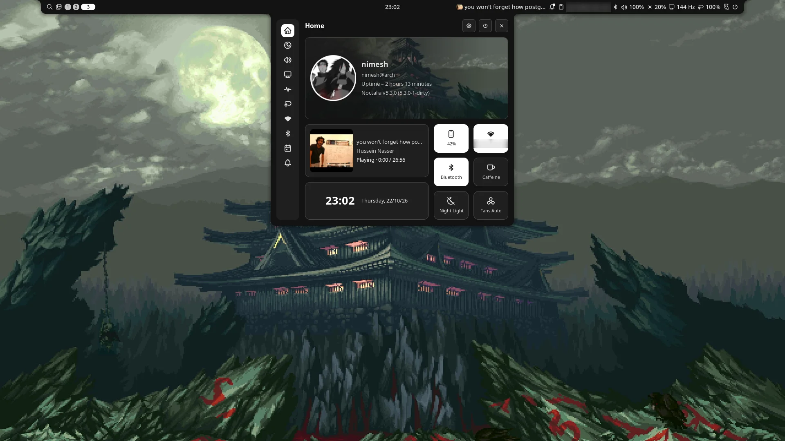
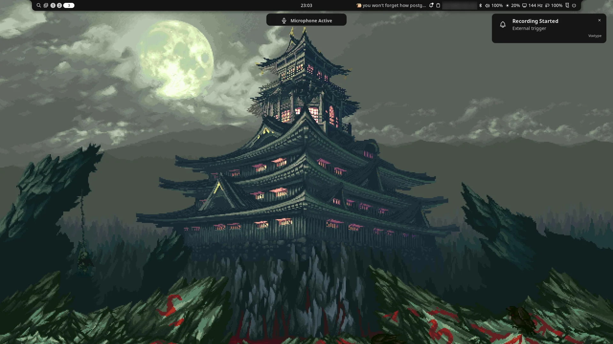
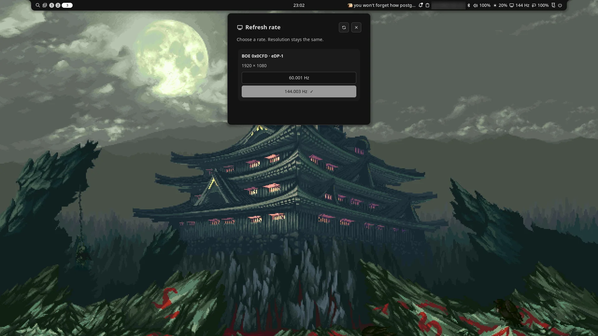

# Linux configs

Clone with submodules so the vendored awesome libraries (lain, freedesktop) are included:

```sh
git clone --recurse-submodules https://github.com/NimeshJohari02/dotfiles.git
```

Personal Linux configuration files. The `niri/` directory contains the Niri setup and keybinding notes. The `noctalia/` directory contains dock and external display brightness settings, KDE Connect integration, a phone avatar, and a panel customization. See [Noctalia setup](noctalia/README.md) for installation.

To activate the Noctalia override, copy `noctalia/90-linux-configs.toml` to `~/.config/noctalia/`. Noctalia reads TOML files from that directory and applies its GUI-managed `~/.local/state/noctalia/settings.toml` as a later override.
The `keyring/` directory documents the shared GNOME Keyring setup for Niri and COSMIC. It contains no keyring database or credentials.

The `dictation/` directory contains the local Phonon-2/Voxtype configuration,
user services, and [restore instructions](dictation/README.md). Press `Super+V`
to start/stop voice dictation. The Niri bindings and Alacritty TOML include the
clipboard and paste settings used by this setup.

The [movie-server setup](movie-server/README.md) shares local movies and SRT
subtitles directly to a TV with ReadyMedia/DLNA. The [Noctalia setup](noctalia/README.md)
also includes a local refresh-rate plugin for Niri, independent of package updates.

## Screenshots

Noctalia control center with the Victus fan toggle:



Voxtype dictation after `Super+V`:



Refresh-rate plugin panel:



Licensed under [MIT](LICENSE). Vendored code under `awesome/` (lain, awesome-wm-widgets, freedesktop) keeps its upstream license.
